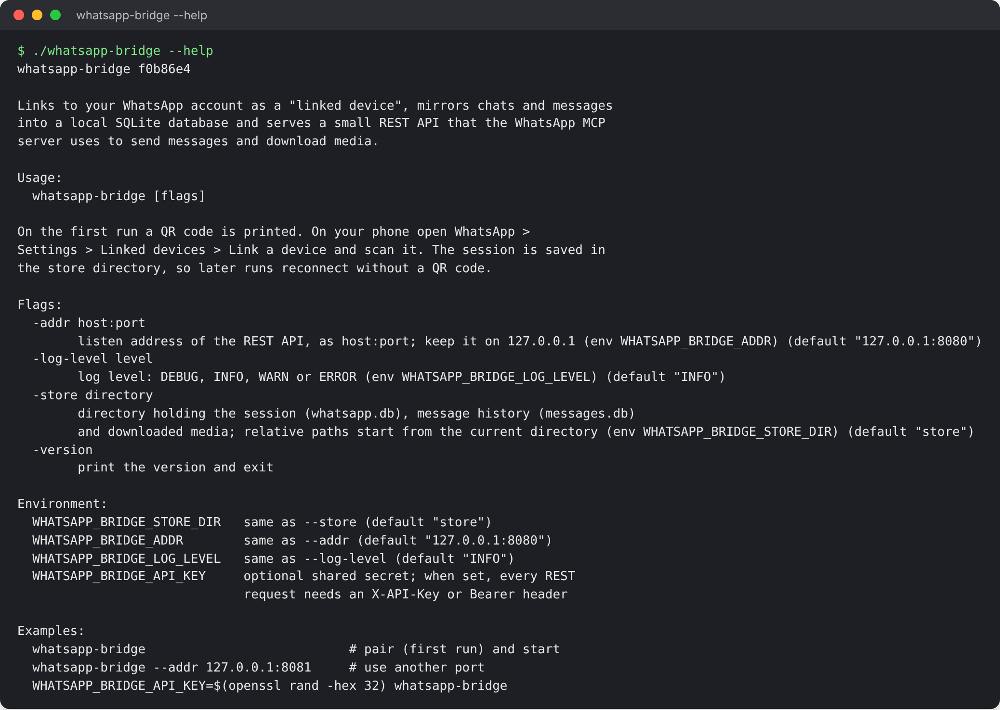
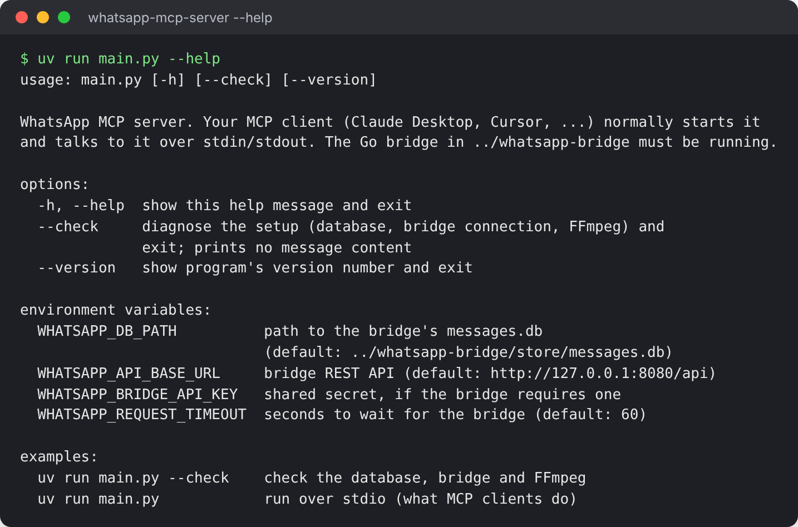
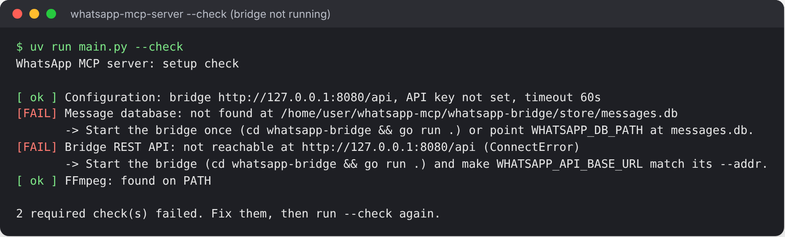
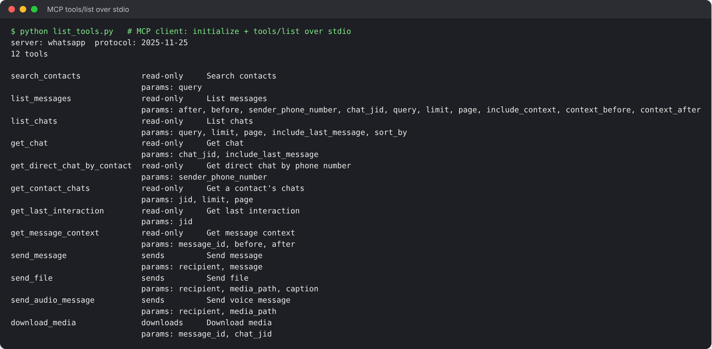
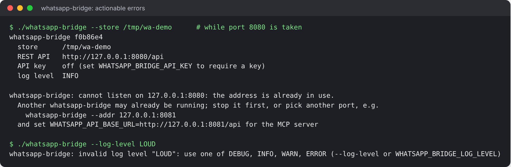
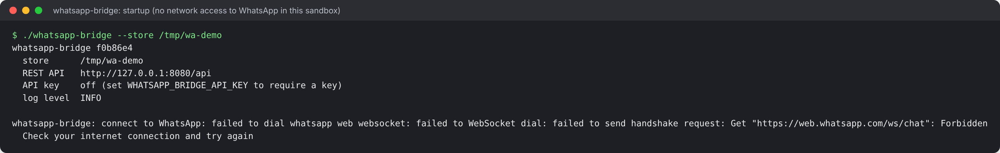
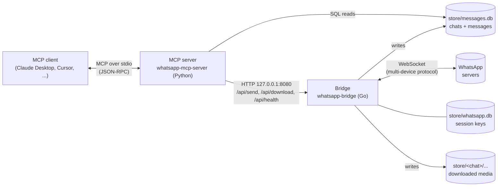

# WhatsApp MCP Server


**Let Claude Desktop, Cursor or any other MCP client search, read and send messages from your own WhatsApp account. Your data stays on your machine.**

> [!NOTE]
> This is a fork of **[lharries/whatsapp-mcp](https://github.com/lharries/whatsapp-mcp)**, created by [Luke Harries](https://github.com/lharries). All credit for the original idea and design goes to the upstream project. This fork updates the dependencies, hardens security, adds tests, improves the command-line experience and documents everything in detail. It is still distributed under the original [MIT License](./LICENSE).

---

## Contents

- [Overview](#overview)
- [Screenshots](#screenshots)
- [Features](#features)
- [Tech stack](#tech-stack)
- [Architecture](#architecture)
- [Project structure](#project-structure)
- [Prerequisites](#prerequisites)
- [Installation](#installation)
- [First run: linking your WhatsApp account](#first-run-linking-your-whatsapp-account)
- [Connecting an MCP client](#connecting-an-mcp-client)
- [Configuration](#configuration)
- [Command-line reference](#command-line-reference)
- [MCP tools reference](#mcp-tools-reference)
- [Bridge REST API](#bridge-rest-api)
- [Usage examples](#usage-examples)
- [Media handling](#media-handling)
- [Running the bridge in the background](#running-the-bridge-in-the-background)
- [Development](#development)
- [Troubleshooting and FAQ](#troubleshooting-and-faq)
- [Security notes](#security-notes)
- [Known limitations](#known-limitations)
- [Roadmap ideas](#roadmap-ideas)
- [Contributing](#contributing)
- [Credits and license](#credits-and-license)

## Overview

This project is a [Model Context Protocol](https://modelcontextprotocol.io) (MCP) server for WhatsApp. It has two parts that run on your own computer:

1. **The bridge** (`whatsapp-bridge/`, Go). It links to your **personal WhatsApp account** as a "linked device" through the WhatsApp Web multi-device protocol (using the [whatsmeow](https://github.com/tulir/whatsmeow) library). It saves your chats and messages to a local SQLite database and offers a small REST API for sending messages and downloading media.
2. **The MCP server** (`whatsapp-mcp-server/`, Python). Your MCP client starts it and talks to it over stdio. It reads the bridge's database to answer questions and calls the bridge to send messages and fetch media.

**Who it's for:** people who want an AI assistant to help with their own WhatsApp: finding an old message, summarising a group chat, drafting and sending a reply, or pulling a shared document into a conversation. It's designed for one person on their own machine, not for bulk messaging or business accounts.

Messages only reach the language model when the assistant calls one of the tools. Most MCP clients ask you to approve each call.


> [!CAUTION]
> Like many MCP servers, this one is exposed to [the lethal trifecta](https://simonwillison.net/2025/Jun/16/the-lethal-trifecta/). It gives an agent access to private data (your chats), to untrusted content (messages other people send you) and to a way of communicating externally (sending messages). A prompt injection hidden in an incoming message could trick the agent into leaking data. Review tool calls before you approve them, especially `send_message`, `send_file` and `send_audio_message`. See [Security notes](#security-notes).

## Screenshots

These are real captures of the commands in this repository, produced in a sandbox **without** network access to WhatsApp and without a paired phone. They show no personal data. Live pairing (scanning the QR code) couldn't be captured there. The pairing instructions printed by the bridge are reproduced as text in [First run](#first-run-linking-your-whatsapp-account).

| | |
| --- | --- |
| **Bridge help** (`whatsapp-bridge --help`) | **MCP server help** (`uv run main.py --help`) |
|  |  |
| **Setup check** (`uv run main.py --check`, bridge not started yet) | **What an MCP client sees** (`initialize` + `tools/list` over stdio) |
|  |  |
| **Actionable errors** (port already in use, bad flag value) | **Bridge startup** (the WhatsApp connection is blocked in the sandbox) |
|  |  |

## Features

- **Search and read** chats, contacts and messages. Filter by date range, sender, chat and text, with pagination.
- **Message context**: fetch the messages just before and after any message.
- **Send text** to a person (by phone number or JID) or a group (by JID).
- **Send files**: images, videos, documents and raw audio, with an optional caption (up to 100 MiB).
- **Voice notes**: send any audio file as a playable WhatsApp voice message. Files that aren't Ogg Opus are converted with FFmpeg.
- **Download incoming media** (images, videos, audio, documents) on demand and get a local file path.
- **History sync**: imports the message history WhatsApp shares when a device is linked, then keeps receiving new messages.
- **Clear tool schemas**: every tool has a title, a description, per-parameter descriptions with bounds and enums, and read-only or sending hints that clients can use to decide what needs approval.
- **Setup check**: `main.py --check` diagnoses the configuration, the database, the bridge connection, pairing status and FFmpeg, and tells you how to fix each problem.
- **Friendly CLI**: `--help` and `--version` on both programs, a configuration summary at startup, step-by-step pairing instructions, and errors that say what to do next (for example, a port that's already taken).
- **Local by default**: the bridge's REST API listens on `127.0.0.1` and can require an API key.

## Tech stack

| Area | Technology | Notes |
| --- | --- | --- |
| WhatsApp connection | [whatsmeow](https://github.com/tulir/whatsmeow) (Go) | WhatsApp Web multi-device protocol |
| Bridge language | Go 1.26 | whatsmeow requires Go 1.26 or newer |
| Storage | SQLite via [go-sqlite3](https://github.com/mattn/go-sqlite3) | Needs CGO and a C compiler |
| Bridge API | Go `net/http` | JSON over HTTP on `127.0.0.1:8080` |
| QR codes | [qrterminal](https://github.com/mdp/qrterminal) | Rendered in the terminal |
| MCP server | Python 3.11+, [MCP Python SDK](https://github.com/modelcontextprotocol/python-sdk) 1.x (FastMCP) | stdio transport |
| HTTP client | [httpx](https://www.python-httpx.org/) | Talks to the bridge |
| Schemas | [Pydantic](https://docs.pydantic.dev/) | Tool parameter validation and JSON Schema |
| Audio conversion | [FFmpeg](https://ffmpeg.org/) (optional) | Converts audio to Ogg Opus voice notes |
| Packaging | [uv](https://docs.astral.sh/uv/) | Locked dependencies in `uv.lock` |
| Quality | pytest, ruff, mypy (strict), `go test -race`, `go vet`, gofmt, staticcheck | Wrapped by the `Makefile` |

## Architecture



How a request flows:

- **Reading** (for example `list_messages`): the MCP server queries `messages.db` directly with SQLite. The bridge isn't involved, so reads work even while the bridge is stopped (you just won't get new messages).
- **Sending** (`send_message`, `send_file`, `send_audio_message`): the MCP server validates the input, resolves file paths to absolute paths, converts audio if needed, and calls `POST /api/send` on the bridge. The bridge uploads media and sends the message over its WhatsApp connection.
- **Downloading** (`download_media`): the MCP server calls `POST /api/download`. The bridge looks up the media keys it stored for that message, downloads and decrypts the file into `store/`, and returns its absolute path.
- **Receiving**: the bridge stores every incoming message and history-sync batch in `messages.db`. Media is stored as metadata only until you download it.

Timestamps are stored in UTC and shown in your local time zone. `messages.db` has indexes on `(chat_jid, timestamp)`, `timestamp` and `sender`.

## Project structure

```
.
├── .github/workflows/ci.yml    # CI: lint, test and build both components
├── .env.example                # Every supported environment variable, with defaults
├── Makefile                    # lint / test / build / fmt / check shortcuts
├── LICENSE                     # MIT license from the upstream project
├── docs/screenshots/           # Terminal captures used in this README
├── example-use.png             # Screenshot from the upstream project
├── whatsapp-bridge/            # Go: WhatsApp connection + REST API
│   ├── main.go                 # Startup, port binding, QR pairing, graceful shutdown
│   ├── config.go               # Flags + environment config, validation, --help text
│   ├── api.go                  # REST handlers, API-key middleware, server timeouts
│   ├── events.go               # Live messages, history sync, chat names
│   ├── store.go                # SQLite schema and queries (messages.db)
│   ├── send.go                 # Recipient parsing, text and media sending
│   ├── media.go                # Media metadata, safe local paths, downloads
│   ├── ogg.go                  # Ogg Opus duration + waveform for voice notes
│   ├── *_test.go               # Unit tests
│   ├── testdata/               # Real FFmpeg-encoded voice note fixture
│   └── go.mod / go.sum         # Go module (module name: whatsapp-client)
└── whatsapp-mcp-server/        # Python: MCP server
    ├── main.py                 # Tool definitions, schemas, CLI entry point
    ├── whatsapp.py             # SQLite queries, formatting, bridge REST client
    ├── doctor.py               # The --check setup diagnostics
    ├── audio.py                # FFmpeg conversion to Ogg Opus
    ├── config.py               # Environment configuration
    ├── tests/                  # pytest suite (fixture DB + mocked bridge)
    └── pyproject.toml / uv.lock
```

## Prerequisites

| Requirement | Why | How to check |
| --- | --- | --- |
| **Go 1.26+** | Builds and runs the bridge (whatsmeow needs 1.26) | `go version` |
| **CGO + a C compiler** (gcc or clang) | go-sqlite3 is a C library | `go env CGO_ENABLED` prints `1`; `gcc --version` |
| **Python 3.11+** | Runs the MCP server | `python3 --version` |
| **[uv](https://docs.astral.sh/uv/)** | Installs the locked Python dependencies and runs the server | `uv --version` |
| **An MCP client** | Claude Desktop, Cursor, or any other client that supports stdio servers | |
| **A phone with WhatsApp** | Links the bridge as a device | |
| **FFmpeg** (optional) | Only for sending non-`.ogg` audio as voice notes | `ffmpeg -version` |

Install uv with `curl -LsSf https://astral.sh/uv/install.sh | sh` (see the [uv docs](https://docs.astral.sh/uv/getting-started/installation/) for Windows). If your Go is older than 1.26 and `GOTOOLCHAIN` is left at its default (`auto`), `go` downloads the right toolchain automatically the first time you build.

## Installation

1. **Clone the repository**

   ```bash
   git clone https://github.com/jeevithg090/whatsapp-mcp.git
   cd whatsapp-mcp
   ```

2. **Build the bridge**

   ```bash
   make build            # or: cd whatsapp-bridge && go build -o whatsapp-bridge .
   ```

   This creates `whatsapp-bridge/whatsapp-bridge`. You can also skip building and use `go run .` inside `whatsapp-bridge/`.

3. **Install the MCP server's dependencies**

   ```bash
   cd whatsapp-mcp-server
   uv sync
   cd ..
   ```

   uv creates a virtual environment in `whatsapp-mcp-server/.venv` from `uv.lock`. (Your MCP client runs `uv run`, which would also do this on first start, but doing it now surfaces problems early.)

4. **Link your account**: see the next section.

5. **Check the setup** once the bridge is running:

   ```bash
   make check            # or: cd whatsapp-mcp-server && uv run main.py --check
   ```

### Windows

go-sqlite3 needs **CGO**, which is off by default on Windows. Install a C compiler (for example via [MSYS2](https://www.msys2.org/), adding `ucrt64\bin` to your `PATH`; see [this guide](https://code.visualstudio.com/docs/cpp/config-mingw)), then:

```bash
cd whatsapp-bridge
go env -w CGO_ENABLED=1
go run .
```

Without CGO you'll see `Binary was compiled with 'CGO_ENABLED=0', go-sqlite3 requires cgo to work.` Windows hasn't been tested in this fork.

## First run: linking your WhatsApp account

Start the bridge in a terminal you can see:

```bash
cd whatsapp-bridge
./whatsapp-bridge          # or: go run .
```

It first prints a summary of its configuration (version, store directory, REST API address, whether an API key is required, log level). It binds the REST API port **before** pairing, so if the port is taken you find out straight away rather than after scanning a code.

With no saved session, the bridge prints these instructions followed by a QR code:

```
No saved session found: link this bridge to your WhatsApp account.
  1. Open WhatsApp on your phone.
  2. Go to Settings > Linked devices > Link a device.
  3. Scan the QR code below. A new code appears every ~20 seconds if it expires.
     (If the code looks broken, make the terminal window wider.)
```

After a successful scan it logs `Paired successfully. History sync can take a few minutes for large accounts.`, starts the REST API and prints:

```
Ready. Messages are being saved to /path/to/whatsapp-bridge/store/messages.db
Keep this running while you use the MCP server. Press Ctrl+C to stop.
```

If nobody scans in time, the bridge exits with `no QR code was scanned in time; run the bridge again to get a fresh code`.

The session is saved in `store/whatsapp.db`. Later runs log `Using saved session for <your number>` and reconnect without a QR code.

> [!IMPORTANT]
> Pairing couldn't be tested live while preparing this fork (no phone or WhatsApp network access was available). The flow above is what the code prints. Please report anything that differs.

## Connecting an MCP client

The MCP server is a stdio server: the client launches it. Point the client at `uv` and the `whatsapp-mcp-server` directory. Get the absolute paths with `which uv` and, in the repository root, `pwd`.

### Claude Desktop

Edit `claude_desktop_config.json` (**Settings → Developer → Edit Config**, or open it directly: `~/Library/Application Support/Claude/` on macOS, `%APPDATA%\Claude\` on Windows):

```json
{
  "mcpServers": {
    "whatsapp": {
      "command": "/absolute/path/to/uv",
      "args": [
        "--directory",
        "/absolute/path/to/whatsapp-mcp/whatsapp-mcp-server",
        "run",
        "main.py"
      ]
    }
  }
}
```

Restart Claude Desktop. The WhatsApp tools should be listed in the tools menu.

### Cursor

Save the same JSON as `~/.cursor/mcp.json` (all projects) or `.cursor/mcp.json` in a project, then reload Cursor.

### Claude Code

```bash
claude mcp add whatsapp -- /absolute/path/to/uv --directory /absolute/path/to/whatsapp-mcp/whatsapp-mcp-server run main.py
```

### Other clients

Any client that can start a stdio MCP server works. The command is `uv`, and the arguments are `--directory <path>/whatsapp-mcp-server run main.py`.

### Passing settings to the server

If you set an API key on the bridge, changed its address, or moved its store, pass the matching settings in an `env` block:

```json
{
  "mcpServers": {
    "whatsapp": {
      "command": "/absolute/path/to/uv",
      "args": ["--directory", "/absolute/path/to/whatsapp-mcp/whatsapp-mcp-server", "run", "main.py"],
      "env": {
        "WHATSAPP_BRIDGE_API_KEY": "the-same-secret-as-the-bridge",
        "WHATSAPP_API_BASE_URL": "http://127.0.0.1:8080/api",
        "WHATSAPP_DB_PATH": "/absolute/path/to/whatsapp-mcp/whatsapp-bridge/store/messages.db"
      }
    }
  }
}
```

Before restarting the client, run `uv run main.py --check` with the same variables set to make sure the server can see the database and the bridge.

## Configuration

All settings are optional. [`.env.example`](./.env.example) lists them with their defaults. **Neither program loads a `.env` file itself.** Export the bridge's variables in its shell (for example `set -a; source .env; set +a`) and put the server's in your MCP client's `env` block.

### Bridge (`whatsapp-bridge`)

Flags take precedence over environment variables.

| Flag | Environment variable | Required | Default | Description |
| --- | --- | --- | --- | --- |
| `--store` | `WHATSAPP_BRIDGE_STORE_DIR` | No | `store` (relative to the working directory) | Directory for `whatsapp.db` (session keys), `messages.db` (history) and downloaded media. Created with owner-only permissions |
| `--addr` | `WHATSAPP_BRIDGE_ADDR` | No | `127.0.0.1:8080` | `host:port` the REST API listens on. The bridge warns if this isn't a loopback address |
| `--log-level` | `WHATSAPP_BRIDGE_LOG_LEVEL` | No | `INFO` | `DEBUG`, `INFO`, `WARN` or `ERROR` (case-insensitive) |
| — | `WHATSAPP_BRIDGE_API_KEY` | No | _unset_ | Shared secret. When set, every REST request must send it as `X-API-Key: <key>` or `Authorization: Bearer <key>`. Compared in constant time |
| `--version` | — | — | — | Print the version and exit |
| `-h`, `--help` | — | — | — | Print usage and exit |

### MCP server (`whatsapp-mcp-server`)

| Environment variable | Required | Default | Description |
| --- | --- | --- | --- |
| `WHATSAPP_DB_PATH` | No | `../whatsapp-bridge/store/messages.db` (relative to `whatsapp-mcp-server/`) | Path to the bridge's message database. Set it if you changed the bridge's store directory |
| `WHATSAPP_API_BASE_URL` | No | `http://127.0.0.1:8080/api` | Bridge REST API base URL, including `/api`. Must match the bridge's `--addr` |
| `WHATSAPP_BRIDGE_API_KEY` | Only if the bridge has one | _unset_ | Sent to the bridge in the `X-API-Key` header |
| `WHATSAPP_REQUEST_TIMEOUT` | No | `60` | Seconds to wait for the bridge. Must be a positive number. Uploads of large files can be slow |

Generate a good API key with `openssl rand -hex 32`.

## Command-line reference

### `whatsapp-bridge`

```text
Usage:
  whatsapp-bridge [flags]

Flags:
  -addr host:port      listen address of the REST API (default "127.0.0.1:8080")
  -log-level level     DEBUG, INFO, WARN or ERROR (default "INFO")
  -store directory     session, message history and downloaded media (default "store")
  -version             print the version and exit
```

Flags can be written with one or two dashes (`-addr` or `--addr`). Exit codes: `0` for a normal shutdown (Ctrl+C or SIGTERM) or `--help`/`--version`, `1` for a runtime error (port in use, connection or pairing failure), `2` for invalid flags or configuration.

Examples:

```bash
./whatsapp-bridge                                   # pair (first run) and start
./whatsapp-bridge --addr 127.0.0.1:8081             # use another port
./whatsapp-bridge --store ~/.local/share/whatsapp   # keep the data elsewhere
WHATSAPP_BRIDGE_API_KEY=$(openssl rand -hex 32) ./whatsapp-bridge
```

`make build` stamps the version from `git describe`. A plain `go build` reports `dev`.

### `main.py` (MCP server)

```text
usage: main.py [-h] [--check] [--version]

  --check     diagnose the setup (database, bridge connection, FFmpeg) and exit
  --version   show the version and exit
```

- With no arguments it serves MCP over stdin/stdout, which is what MCP clients do. If you start it by hand in a terminal, it prints a short note on stderr explaining that it's waiting for an MCP client.
- `--check` prints one line per check with `[ ok ]`, `[FAIL]` or `[warn]` and a `->` hint for anything wrong. It exits `0` when every required check passes and `1` otherwise. FFmpeg is optional, so a missing FFmpeg only produces a warning. The report shows counts (chats, messages) and connection states, never message content or contact names.

The checks are:

| Check | Passes when | Typical fix |
| --- | --- | --- |
| Configuration | Environment variables parse (for example, the timeout is a positive number) | Correct the variable |
| Message database | `WHATSAPP_DB_PATH` exists and can be queried | Start the bridge once, or fix `WHATSAPP_DB_PATH` |
| Bridge REST API | `GET /api/health` answers, the API key is accepted, and the bridge reports it is logged in and connected | Start the bridge, scan the QR code, fix `WHATSAPP_API_BASE_URL` or the API key |
| FFmpeg (optional) | `ffmpeg` is on `PATH` | Install FFmpeg if you want to send voice notes from other formats |

## MCP tools reference

**JIDs** identify chats: `<phone>@s.whatsapp.net` for a person (phone number with country code, digits only) and `<id>@g.us` for a group. Use `search_contacts` or `list_chats` to find them.

Read-only tools are annotated `readOnlyHint: true`. The three send tools are annotated as non-read-only and open-world, so clients that respect annotations can ask for confirmation before running them.

### Reading

| Tool | Parameters | Returns |
| --- | --- | --- |
| `search_contacts` | `query` (string, required): part of a name or phone number | Up to 50 contacts: `phone_number`, `name`, `jid`. Groups are excluded |
| `list_messages` | `after`, `before` (ISO-8601 date/time, local time unless an offset is given); `sender_phone_number`; `chat_jid`; `query` (case-insensitive text match); `limit` (1–200, default 20); `page` (≥0, default 0); `include_context` (default `true`); `context_before`, `context_after` (0–50, default 1) | Readable text, newest first, for example `[2025-05-01 10:05:00] Chat: Alice From: Alice: See you at 6`. All filters are optional and combine with AND |
| `list_chats` | `query` (name or JID contains); `limit` (1–200, default 20); `page`; `include_last_message` (default `true`); `sort_by` (`"last_active"` or `"name"`, default `"last_active"`) | Chats with `jid`, `name`, `is_group`, `last_message_time` and optionally the last message |
| `get_chat` | `chat_jid` (required); `include_last_message` (default `true`) | One chat, or `null` if unknown |
| `get_direct_chat_by_contact` | `sender_phone_number` (required) | The one-to-one chat with that number, or `null` |
| `get_contact_chats` | `jid` (required); `limit` (1–200, default 20); `page` | The direct chat with the contact plus groups where they've sent messages |
| `get_last_interaction` | `jid` (required) | The most recent message to or from the contact, as a readable line |
| `get_message_context` | `message_id` (required); `before`, `after` (0–50, default 5) | `{message, before: [...], after: [...]}` from the same chat |

### Sending and media

| Tool | Parameters | Returns |
| --- | --- | --- |
| `send_message` | `recipient` (phone number with country code and digits only, or a JID); `message` (text) | `{success, message}` |
| `send_file` | `recipient`; `media_path` (local file, absolute or relative to the server directory); `caption` (optional) | `{success, message}` |
| `send_audio_message` | `recipient`; `media_path` (audio file; non-`.ogg`/`.opus` files are converted with FFmpeg) | `{success, message}` |
| `download_media` | `message_id`; `chat_jid` (both shown in `list_messages` output for media messages) | `{success, message, file_path}` (`file_path` only on success) |

Problems you can fix (missing database, unknown message, invalid date, bad `sort_by`) come back as MCP tool errors with a message explaining what to do. Send and download failures come back as `{"success": false, "message": "..."}`. Out-of-range arguments (for example `limit: 0`) are rejected by schema validation.

The server also sends MCP `instructions` to clients that support them, explaining JIDs, how to download media, and that sending tools need user confirmation.

## Bridge REST API

The MCP server uses this API. You can also call it yourself, for example from scripts. All bodies are JSON. If `WHATSAPP_BRIDGE_API_KEY` is set, **every** endpoint (including health) requires `X-API-Key: <key>` or `Authorization: Bearer <key>`. Otherwise it returns `401 {"success": false, "message": "unauthorized"}`.

| Method | Path | Auth | Request body | Response |
| --- | --- | --- | --- | --- |
| `GET` | `/api/health` | API key if configured | — | `200 {"status": "ok", "connected": bool, "logged_in": bool}` |
| `POST` | `/api/send` | API key if configured | `{"recipient": "447700900001", "message": "hi", "media_path": "/abs/file.jpg"}` (`message` or `media_path` required; `message` is the caption when sending media) | `200 {"success": true, "message": "Message sent to ..."}`; `400` for missing fields or invalid JSON; `500` with the error otherwise |
| `POST` | `/api/download` | API key if configured | `{"message_id": "...", "chat_jid": "...@s.whatsapp.net"}` | `200 {"success": true, "message": "...", "filename": "...", "path": "/abs/path"}`; `404` if the message or its media isn't found |

Other methods return `405` with an `Allow: POST` header. Request bodies are limited to 1 MiB, and media files to 100 MiB.

```bash
curl -s http://127.0.0.1:8080/api/health
curl -s -X POST http://127.0.0.1:8080/api/send \
  -H 'Content-Type: application/json' \
  -H "X-API-Key: $WHATSAPP_BRIDGE_API_KEY" \
  -d '{"recipient": "447700900001", "message": "Hello from the bridge"}'
```

## Usage examples

Once the client is connected, ask in plain language. The assistant picks the tools, for example:

| You ask | Tools the assistant typically uses |
| --- | --- |
| "What did Alice say about lunch last week?" | `search_contacts` → `list_messages` (`sender_phone_number`, `after`, `query`) |
| "Summarise today's messages in the Book Club group." | `list_chats` (`query: "Book Club"`) → `list_messages` (`chat_jid`, `after`) |
| "Who have I talked to most recently?" | `list_chats` (`sort_by: "last_active"`) |
| "Show me the conversation around that message." | `get_message_context` |
| "Download the PDF Bob sent me yesterday and summarise it." | `list_messages` → `download_media` |
| "Reply to Alice: 'Running 10 minutes late'." | `get_direct_chat_by_contact` → `send_message` (approve the call) |
| "Send ~/Pictures/plan.png to the Book Club group with the caption 'Thoughts?'" | `list_chats` → `send_file` |
| "Send this recording as a voice note to Bob." | `send_audio_message` |

Example `list_messages` output (from the test fixtures, with made-up data):

```text
[2025-05-01 10:05:00] Chat: Alice From: Alice: [image - Message ID: a4 - Chat JID: 447700900001@s.whatsapp.net]
[2025-05-01 10:02:00] Chat: Alice From: Alice: Great, 100% there
```

## Media handling

- **Sending**: the type is chosen by file extension. `.jpg`, `.jpeg`, `.png`, `.gif` and `.webp` are sent as images; `.mp4`, `.mov` and `.avi` as videos; `.ogg` and `.opus` as voice notes (with duration and waveform computed from the file); anything else as a document, with the MIME type guessed from the extension. The limit is 100 MiB. Relative paths are resolved by the MCP server before being passed to the bridge, because the two run in different directories.
- **Voice notes from other formats**: `send_audio_message` converts the file to Ogg Opus with FFmpeg into a temporary file, sends it, then deletes the temporary file.
- **Receiving**: only metadata is stored at first. Messages show as `[image - Message ID: … - Chat JID: …]`. `download_media` fetches the file into `whatsapp-bridge/store/<chat>/`. Filenames are sanitised and prefixed with the message ID, so a sender-chosen name can't escape the store directory or overwrite another file. Downloads are cached: asking again returns the existing file.

## Running the bridge in the background

The bridge has to keep running for sending, downloading and receiving new messages. Pair interactively the first time, then run the built binary under a process manager.

**systemd (Linux, user service)**: `~/.config/systemd/user/whatsapp-bridge.service`

```ini
[Unit]
Description=WhatsApp MCP bridge
After=network-online.target

[Service]
WorkingDirectory=/absolute/path/to/whatsapp-mcp/whatsapp-bridge
ExecStart=/absolute/path/to/whatsapp-mcp/whatsapp-bridge/whatsapp-bridge
Restart=on-failure
# Environment=WHATSAPP_BRIDGE_API_KEY=...

[Install]
WantedBy=default.target
```

```bash
systemctl --user daemon-reload
systemctl --user enable --now whatsapp-bridge
journalctl --user -u whatsapp-bridge -f
```

On macOS, use a launchd agent with the same working directory and binary, or simply a `tmux`/`screen` session. Log colours are turned off automatically when output isn't a terminal, so logs stay readable in journald and files.

The bridge reads local files passed to `/api/send` and writes media to its store, so the MCP server and the bridge must share a filesystem. That's why there's no container image.

## Development

The `Makefile` wraps everything (CI runs the same steps):

```bash
make lint    # gofmt, go vet, staticcheck, ruff check, ruff format --check, mypy --strict
make test    # go test -race ./... and pytest
make build   # builds whatsapp-bridge/whatsapp-bridge with the git version
make fmt     # gofmt -w, ruff format, ruff check --fix
make check   # runs the MCP server's --check against your setup
make run-bridge / make run-server
```

Or directly:

```bash
# Go bridge
cd whatsapp-bridge
go test -race ./...
go vet ./...
go run honnef.co/go/tools/cmd/staticcheck@v0.8.2 ./...

# Python MCP server
cd whatsapp-mcp-server
uv sync
uv run pytest
uv run ruff check . && uv run ruff format --check . && uv run mypy
```

### What the tests cover

Nothing in the test suite talks to WhatsApp.

- **Go (27 tests)**: REST handlers, including API-key auth, validation and the health status; the SQLite store; filename sanitisation and path safety; recipient parsing; MIME classification; the Ogg Opus duration parser (using a real FFmpeg-encoded fixture and truncated inputs); configuration parsing (flags overriding the environment, `--help`, `--version`, rejecting invalid values); loopback detection; and the "address already in use" error.
- **Python (69 tests)**: every query against a temporary SQLite database with the bridge's schema; the bridge client against a mocked HTTP transport (auth header, timeouts, unreachable bridge, error bodies); FFmpeg conversion; the `--check` diagnostics (all passing, missing DB and bridge, unpaired bridge, wrong API key, bad config, and that no message content is printed); `--help`/`--version`; tool schemas (every parameter described, annotations, bounds enforced, enums); and an end-to-end MCP session over real stdio, which also proves nothing else is written to stdout.

### Linting and style

- Go: `gofmt`, `go vet` and `staticcheck`.
- Python: `ruff` (lint and format, 120 columns) and `mypy --strict`.
- Logging in the MCP server goes to **stderr only**, because stdout carries the MCP protocol. Keep it that way: a stray `print()` corrupts the stream, and `tests/test_server.py` will catch it.

## Troubleshooting and FAQ

**Start with `make check`** (or `uv run main.py --check` in `whatsapp-mcp-server/`). It pinpoints most problems.

<details open>
<summary><strong>Pairing and sessions</strong></summary>

- **The QR code looks garbled.** Make the terminal wider or reduce the font size, then run the bridge again.
- **"no QR code was scanned in time".** The first code lasts about a minute and later ones about 20 seconds; after several codes pairing times out. Run the bridge again for fresh codes.
- **"pairing failed".** Run the bridge again. If it keeps failing, remove an old linked device in WhatsApp (**Settings → Linked devices**) and retry. WhatsApp limits how many devices can be linked.
- **How long does a session last?** WhatsApp decides. Linked devices can be logged out, for example after a long time without your phone being online; the upstream project reports needing to re-link roughly every 20 days. When that happens the bridge logs `Device logged out; restart the bridge and scan the QR code to log in again`.
- **Logged out or out of sync.** Stop the bridge, delete `whatsapp-bridge/store/whatsapp.db` (and `messages.db` if you also want a clean history), then start it again and re-link.
- **No messages after linking.** History sync runs in the background and can take several minutes for large accounts. `--check` shows the message count growing.

</details>

<details open>
<summary><strong>Ports and connectivity</strong></summary>

- **"cannot listen on 127.0.0.1:8080: the address is already in use".** Another bridge (or another program) is using the port. Stop it, or start the bridge with `--addr 127.0.0.1:8081` and set `WHATSAPP_API_BASE_URL=http://127.0.0.1:8081/api` for the MCP server. On Linux and macOS, `lsof -i :8080` shows what's using it.
- **"Could not reach the WhatsApp bridge".** The bridge isn't running, or `WHATSAPP_API_BASE_URL` doesn't match its `--addr`.
- **"the bridge is not connected to WhatsApp right now".** The bridge is running but its WhatsApp connection dropped. It reconnects automatically; check its terminal and your internet connection.
- **"connect to WhatsApp: ... Forbidden" or a timeout.** Something (a firewall, proxy or VPN) is blocking `web.whatsapp.com`.
- **"check WHATSAPP_BRIDGE_API_KEY" / 401.** The key set for the MCP server doesn't match the bridge's.

</details>

<details open>
<summary><strong>MCP client</strong></summary>

- **The client says the server failed to start, or `uv` isn't found.** Use the absolute path from `which uv` in the config. GUI apps often don't inherit your shell's `PATH`.
- **"Message database not found".** Start the bridge at least once, or set `WHATSAPP_DB_PATH` to the right `messages.db` (needed if you used `--store` or ran the bridge from another directory).
- **Tools don't appear.** Fully restart the client after editing its config. Claude Desktop writes logs to `~/Library/Logs/Claude/` on macOS and `%APPDATA%\Claude\logs` on Windows. See the [MCP debugging guide](https://modelcontextprotocol.io/docs/tools/debugging).
- **Running `uv run main.py` by hand just waits.** That's expected: it's waiting for an MCP client on stdin. Use `--check` or `--help` instead.

</details>

<details open>
<summary><strong>Media and audio</strong></summary>

- **"ffmpeg is not installed or not on PATH".** Install FFmpeg, or use `send_file` to send the audio as an attachment instead of a voice note.
- **"Media file not found".** Paths are resolved on the machine running the MCP server. Relative paths are relative to `whatsapp-mcp-server/`, so prefer absolute paths.
- **Build error about CGO.** See [Windows](#windows), or install gcc/clang and make sure `go env CGO_ENABLED` prints `1`.

</details>

## Security notes

- **Your WhatsApp session keys and full message history** are in `whatsapp-bridge/store/`. Anyone with that directory can read your messages and act as your linked device. It's git-ignored and created with owner-only permissions. Don't sync it to shared or cloud locations or include it in backups you don't control.
- **The REST API can send messages as you and read any local file** the bridge's user can read (via `media_path`). It listens on `127.0.0.1` by default. Keep it there. If you must expose it, set `WHATSAPP_BRIDGE_API_KEY` and put it behind TLS; the bridge itself speaks plain HTTP and logs a warning when bound to a non-loopback address.
- **Without an API key, any local process can use the API.** On a shared machine, set `WHATSAPP_BRIDGE_API_KEY`.
- **Prompt injection is a real risk.** Incoming messages are untrusted text that the model reads. Keep tool approval on for the send tools, and be suspicious of any request to forward content or send files you didn't ask for.
- **Data sent to your model provider:** whatever the tools return (message text, contact names, file contents you ask it to read) goes to the model behind your MCP client.
- **Unofficial client:** whatsmeow is not an official WhatsApp API. Using unofficial clients may go against WhatsApp's Terms of Service. Use your own account responsibly and never for spam or bulk messaging.

## Known limitations

- **Not tested live in this fork.** Pairing, sending and media download against real WhatsApp couldn't be verified while preparing these changes. Unit tests use fakes. Please smoke-test after pairing.
- **Text messages don't show their message ID** in `list_messages` output, only media messages do. `get_message_context` returns IDs.
- **Only text and common media are stored**: messages with neither text nor an image, video, audio or document (reactions, edits, deletions, polls, stickers, locations, contact cards) are skipped by the bridge.
- **Contacts come from chats**: `search_contacts` searches chats seen by the bridge, not your phone's full address book.
- **One account, one bridge.** Multiple accounts need separate stores and ports.
- **Chat names are not refreshed**: a chat's name is saved the first time it's seen. If a group's name couldn't be looked up then, it's stored as `Group <id>`, and renames aren't picked up later.
- **Windows** isn't tested in this fork.
- **Existing databases** created by older versions stored timestamps in local time. Ordering around those rows can be off; delete `store/messages.db` and re-sync for consistent data.

## Roadmap ideas

These are ideas, not commitments:

- Show message IDs for every message in `list_messages` so any message can be quoted or used as context.
- Pairing by phone number code as an alternative to scanning a QR code.
- Mark-as-read, reactions and replies (quoted messages).
- An optional MCP resource listing recent chats.
- Prebuilt bridge binaries for common platforms.
- Packaging the MCP server so it can run with `uvx` without cloning.

## Contributing

Contributions are welcome. Before opening a pull request:

1. Run `make fmt`, then `make lint test build`. All three must pass.
2. Add tests for behaviour changes. Use the fixture database in `whatsapp-mcp-server/tests/conftest.py` and the fake bridge in `whatsapp-bridge/api_test.go`. Never include real phone numbers or messages in tests or screenshots; use the reserved UK test range (`447700900xxx`).
3. Keep the MCP server's stdout clean (log to stderr) and keep tool parameters documented with `Field(description=...)`.
4. Update this README when you add a tool, flag, environment variable or endpoint.

Bugs that affect the original design may also belong upstream at [lharries/whatsapp-mcp](https://github.com/lharries/whatsapp-mcp).

## Credits and license

- Originally created by **[Luke Harries](https://github.com/lharries)**: [lharries/whatsapp-mcp](https://github.com/lharries/whatsapp-mcp).
- WhatsApp protocol support by [whatsmeow](https://github.com/tulir/whatsmeow) (Tulir Asokan and contributors).
- MCP support by the [Model Context Protocol Python SDK](https://github.com/modelcontextprotocol/python-sdk).

This fork keeps the upstream **[MIT License](./LICENSE)** (Copyright (c) 2025 Luke Harries). Not affiliated with or endorsed by WhatsApp or Meta.
